## Модуль 7: Управление пользователями и уведомления

---

**Задание: настройка управления пользователями и уведомлений.**
---
**План**  

- Настройка Telegram. 
- Настройка профиля пользователя.
- Настройка оповещения о проблемах.

---
### Практическая работа 7.1

#### 1. Настройка уведомлений

##### 1.1. **Настройте уведомления:**
> Предварительно получите данные от тренера для настройки уведомлений в Telegram (для получения токена можно самостоятельно создать Telegram-бот ***см. Приложение 3***)

- перейдите в **Оповещения -> Способы оповещений**
  
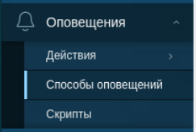

- выберите **Telegram** и `активируйте` его

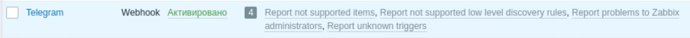

- нажмите на ссылку **`Telegram`** , чтобы перейти в настройки
- укажите токен в поле `Параметры - Token:`

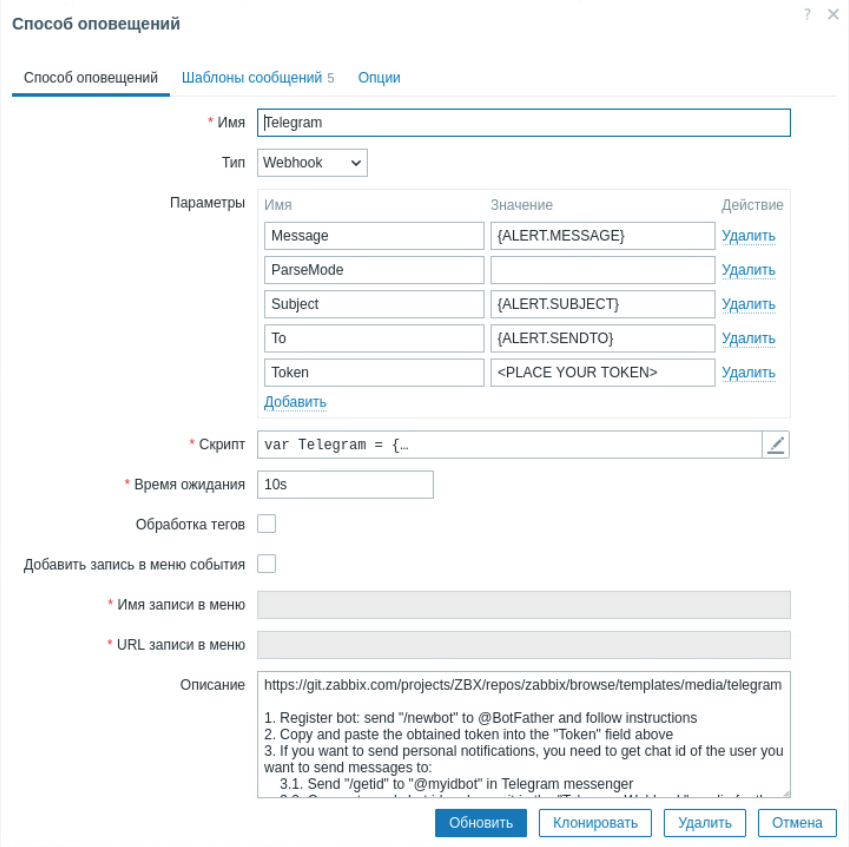

- нажмите **`Обновить`**.

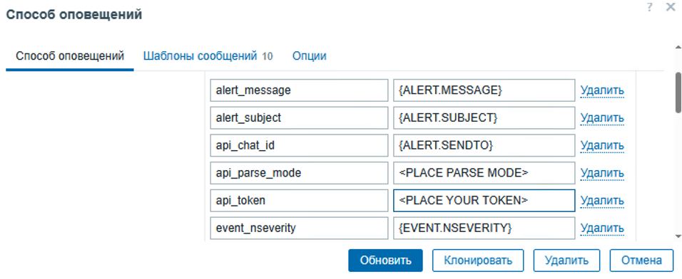

##### 1.2. **Настройте уведомления по Email:**
> В качестве SMTP-сервера используется **MailCatcher**, запущенный на сервере Zabbix (`localhost`, порт `1025`). Он принимает все письма без аутентификации и показывает их в веб-интерфейсе — реальная отправка почты не производится.

- перейдите в **Оповещения -> Способы оповещений**
- выберите **Email** и `активируйте` его
- нажмите на ссылку **`Email`**, чтобы перейти в настройки
- на вкладке `Способ оповещения` заполните поля:
  - `Поставщик почты`: **Generic SMTP**
  - `SMTP сервер`: **localhost**
  - `Порт SMTP сервера`: **1025**
  - `Email`: **zabbix@example.local** (адрес отправителя, будет указан в поле «От»)
  - `SMTP helo`: **example.local**
  - `Безопасность подключения`: **Нет**
  - `Аутентификация`: **Нет**
  - `Формат сообщения`: **HTML**
- нажмите **`Обновить`**.

##### 1.3. **Проверьте отправку почты:**
- в списке **Оповещения -> Способы оповещений** в строке **Email** нажмите ссылку **`Тест`** (столбец `Действия`)
- в открывшемся окне в поле `Отправить на` укажите адрес, например **admin@example.local** (MailCatcher принимает письма на любой адрес)
- поля `Тема` и `Сообщение` можно оставить по умолчанию, нажмите **`Тест`**
- должно появиться сообщение **«Тест способа оповещения успешен»**
- откройте в браузере веб-интерфейс MailCatcher: **http://10.0.20.10:1080**
- убедитесь, что тестовое письмо появилось в списке, откройте его и проверьте отправителя, получателя, тему и текст

> Если тест завершился ошибкой, проверьте, что контейнер MailCatcher запущен (`docker ps`) и порт `1025` слушается на сервере Zabbix (`ss -tlnp | grep 1025`).

##### 1.4. **Настройте персонализированный профиль пользователя:**
- перейдите в настройки профиля, чтобы обновить информацию о пользователе и сохраните изменения:
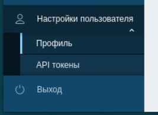
- на вкладке `Пользователь` установите ваш локальный часовой пояс;
- на вкладке `Оповещения` нажмите `Добавить` и выберите `Telegram`;
- В поле `Отправлять на` Укажите ID чата и нажмите `Добавить`;
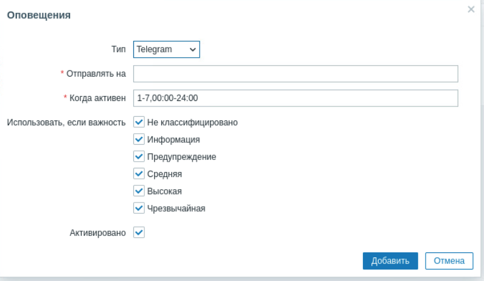
- на вкладке `Оповещения` ещё раз нажмите `Добавить` и выберите `Email`;
- в поле `Отправлять на` укажите адрес **admin@example.local** и нажмите `Добавить`;
- нажмите `обновить` 
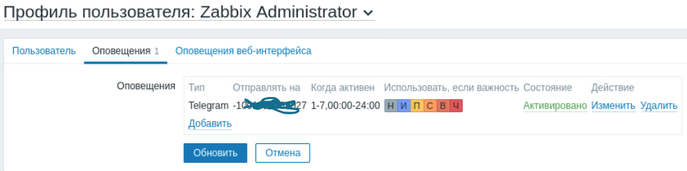  

---

#### 2. Получение оповещения о проблеме

##### 2.1.  **Настройте действие:**
- для настройки оповещений перейдите в `Оповещения → Действия → Действия триггеров` и нажмите на `Создать действие`.
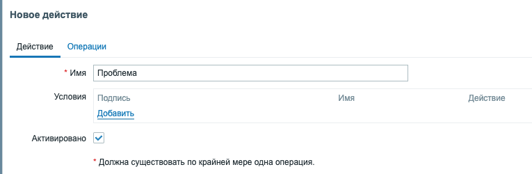
- все обязательные поля ввода отмечены красной звёздочкой.Введите имя действия;
- в поле Условия нажмите добавить и выберите свой триггер и сервер:
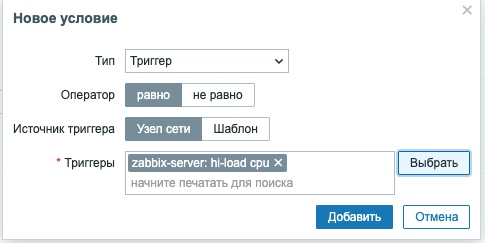
- нужно определить, что именно действие должно делать — это настраивается на вкладке `Операции`. Нажмите в блоке `Операции` на `Добавить`, откроется диалог новой операции. 

- нажмите на `Выбрать` в блоке `Отправка пользователям` и выберите пользователя **«Admin»**, которого мы добавили. В поле `Отправлять способом оповещения` выберите значение **«Telegram»**: 
  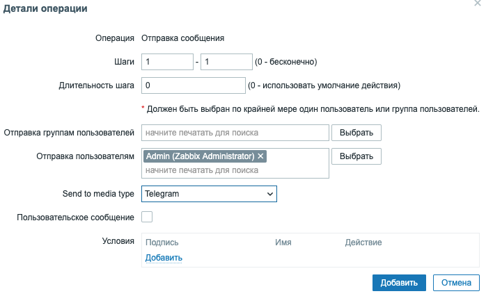
- когда закончите с этим, нажмите на `Добавить`, и операция добавится:
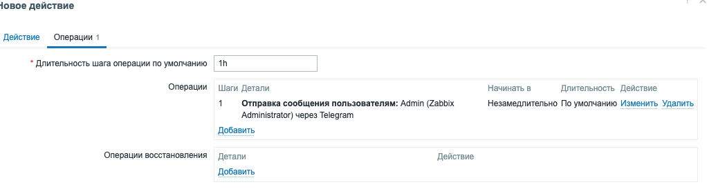

##### 2.2. **Добавьте в действие отправку по Email:**
- в том же действии на вкладке `Операции` в блоке `Операции` снова нажмите `Добавить`, откроется диалог новой операции;
- нажмите на `Выбрать` в блоке `Отправка пользователям` и выберите пользователя **«Admin»**. В поле `Отправлять способом оповещения` выберите значение **«Email»**;
- нажмите `Добавить` — в списке операций появится вторая операция (Telegram и Email);
- нажмите `Добавить` внизу формы действия, чтобы сохранить его (если действие уже было сохранено ранее — `Обновить`);
- после срабатывания триггера откройте веб-интерфейс MailCatcher **http://10.0.20.10:1080** и убедитесь, что письмо о проблеме пришло. Статус отправки также можно проверить в `Отчёты → Журнал действий`.
  
---

#### Лабораторная работа 7.1

1. Добавьте для сервера **gw** новый триггер с именем "Secure fail" и заполните поля как в примере:
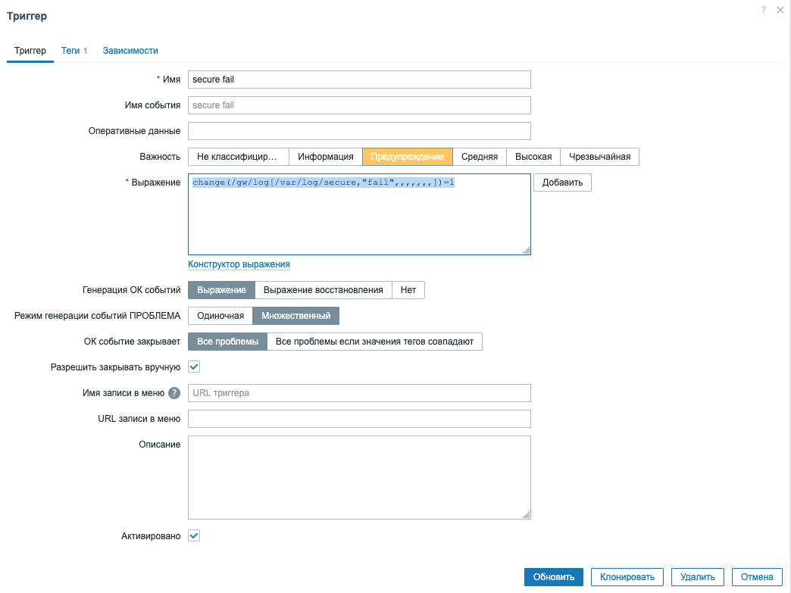
2. Поле **Выражение** заполните как в примере, нажав кнопку **Добавить**
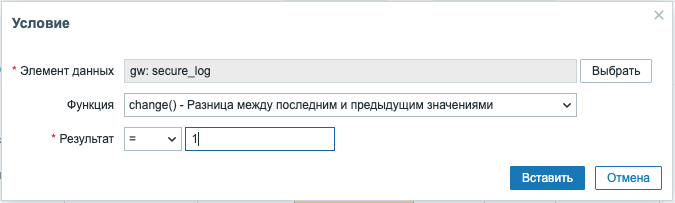
3. Добавьте для сервера **gw** новый триггер с именем "Secure invalid user" **secure_log invalid**
4. Создайте  новое **Уведомление**, которое будет отправлять сообщение в Telegram/Email о неправильных подключениях по ssh на основе созданных триггеров "Secure fail" и "Secure invalid user".
5. Подключитесь по ssh под пользователем VASHA_FAMILA к серверу **gw**, чтобы проверить настройки уведомлений.
